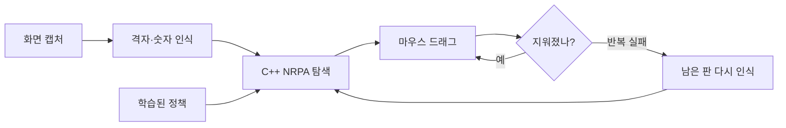

# 사과게임 AI

화면을 읽고, 지우는 순서를 계산하고, 마우스로 직접 플레이하는 퍼즐 AI입니다.

17×10 판에서 합이 10이 되는 직사각형을 골라 사과를 지우는 게임을 다룹니다. 어떤 사각형을 먼저 지우느냐에 따라 이후의 선택지가 달라지는 조합 최적화 문제입니다. 자가 플레이로 학습한 정책과 C++ 탐색 엔진을 결합해 **60초 탐색으로 170개 중 평균 150.3개**를 지우는 순서를 찾습니다. 실제 게임 최고 기록은 **158점**입니다.

**Python · C++17 · NumPy · ctypes · Tkinter · PyInstaller**

## 구조



| 단계 | 파일 | 내용 |
|---|---|---|
| 인식 | `apple_ai/vision.py` | 연결 요소로 사과 170개의 격자를 찾고 템플릿으로 숫자를 판별. 불확실하면 추측하지 않고 중단 |
| 규칙 | `apple_ai/rules.py` | 누적합으로 유효한 직사각형을 열거. 같은 사과를 지우는 사각형은 하나로 통합 |
| 탐색 | `native/engine.cpp` | 멀티스레드 NRPA. Python에서 ctypes로 호출 |
| 학습 | `train.py` | 반사실 기여도를 이용한 정책 경사 |
| 실행 | `apple_ai/player.py`, `app.py` | 드래그 결과 확인과 재시도, 항상 위에 뜨는 제어 패널 |

## 핵심 방법

### 1. 정책 학습

각 수의 점수를 **숫자 조합 41종의 가중치**와 **사각형 특징 7개**의 합으로 나타내고 softmax로 선택합니다. 특징에는 이 수가 없애는 다른 후보의 수, 더 이상 지울 수 없게 되는 사과의 수 등이 들어갑니다.

판 하나의 최종 점수만으로는 어떤 수가 좋았는지 알기 어렵습니다. 그래서 진행 중의 한 상태에서 **가능한 모든 수를 각각 두고 끝까지 진행해 비교**합니다. 같은 난수열로 비교해 분산을 줄이고, 표준오차보다 작은 기울기는 반영하지 않습니다.

### 2. NRPA 탐색

학습된 정책을 출발점으로, 좋은 순서를 찾을 때마다 정책을 그쪽으로 조금씩 옮기며 탐색합니다(Nested Rollout Policy Adaptation). 스레드마다 독립적으로 실행하고 가장 좋은 순서를 사용합니다.

## 결과

숫자 비율을 맞춘 무작위 판에서 지운 사과 수입니다(최대 170, 6코어 PC, 5스레드). 표마다 다른 판을 썼으므로 표끼리는 직접 비교할 수 없습니다.

**탐색 방식 비교** (한 판 60초, 설정을 고를 때 쓰지 않은 새 판 10개)

| 방식 | 평균 | 초기 버전 대비 (95% 구간) | 승/패/무 |
|---|---|---|---|
| **NRPA + 학습 정책** | **150.3** | **+11.0 ± 3.3** | 10/0/0 |
| 가치 함수 빔 탐색 | 147.2 | +7.9 ± 1.7 | 10/0/0 |
| 롤아웃 빔 + 모방 학습 정책 | 145.5 | +6.2 ± 2.6 | 9/0/1 |
| 반복 롤아웃 + 학습 정책 | 142.1 | +2.8 ± 3.1 | 7/2/1 |
| 롤아웃 빔 (C++로 옮긴 것) | 141.4 | +2.1 ± 2.7 | 6/4/0 |
| 롤아웃 빔 (Python, 초기 버전) | 139.3 | 기준 | |

**정책 비교** (탐색 없이, 새 판 3,000개)

| 정책 | 한 번 둘 때 평균 | 100번 중 최고의 평균 |
|---|---|---|
| 수동으로 정한 조합 가중치 | 105.2 | 121.0 |
| 조합 가중치 학습 | 111.0 | 127.7 |
| **조합 + 사각형 특징 학습** | **116.3** | **130.6** |

**계산 시간** (판 20개): 20초 149.2, 40초 150.5

## 실험에서 얻은 것

- **언어보다 알고리즘이 중요했습니다.** C++로 옮기기만 한 효과(+2.1)는 오차 범위 안이었고, 정책과 탐색 방식을 바꾼 효과가 훨씬 컸습니다.
- **섞는다고 좋아지지 않았습니다.** NRPA와 가치 함수 빔을 20초씩 쓰는 방식(149.7)은 같은 40초 동안 NRPA만 쓰는 것(150.5)보다 낫지 않아 제외했습니다.
- **평가 조건이 결론을 바꿉니다.** 초기에는 짧은 시간 제한 때문에 가중치의 효과를 잘못 판단했습니다. 이후에는 같은 판에서 짝지어 비교하고 신뢰구간을 함께 확인했습니다.

이 저장소에는 최종 방식만 있고, 채택하지 않은 방식과 비교 실험 코드는 제외했습니다. 학습의 출발점인 `data/start_weights.json`은 7×10 판에서 먼저 학습한 결과입니다.

## 한계

- 찾은 순서가 최적이라는 보장은 없습니다.
- 60초 비교는 판이 10개뿐이라 점수 차이의 정확한 크기는 달라질 수 있습니다.
- 결과 표는 시뮬레이션 점수입니다. 실제 게임의 158점은 최고 기록이며, 실제 게임의 평균은 측정하지 않았습니다.
- Windows와 주 모니터만 지원하고, 게임의 기본 색상을 전제로 합니다.

## 실행

Windows, Python 3.14(개발 환경), AVX2 지원 CPU, Visual Studio 2022(C++ 데스크톱 개발)가 필요합니다.

```powershell
pip install -r requirements.txt
native\build.cmd
python app.py
```

게임을 시작하고 판 전체가 보이게 한 뒤(연한 색 옵션은 끔) 패널의 **시작**을 누릅니다. 드래그 중 마우스를 움직이거나 Esc를 누르면 중단됩니다. 드래그까지 게임 시간 안에 끝나도록 계산(초)를, 사과가 지워지지 않으면 드래그(ms)를 조절합니다.

```powershell
python -m tests.test_engine                              # 테스트
python train.py                                          # 정책 학습 → policy_new.json
powershell -ExecutionPolicy Bypass -File build_exe.ps1    # dist\AppleGameAI.exe
```

테스트는 C++ 엔진의 후보와 특징을 독립적인 Python 구현과 대조하고, 탐색 경로를 규칙대로 재생해 점수를 확인합니다. 학습은 시드가 고정되어 있어, 다시 실행해 `data/policy.json`과 같은 정책이 나오는 것을 확인했습니다.

## AI 도움

이 프로젝트는 AI 코딩 도구(Claude Code)의 도움을 받아 만들었습니다.

## 라이선스

[MIT License](LICENSE). 개인 학습용 프로젝트이며 원본 게임 제작자와 관련이 없습니다.
